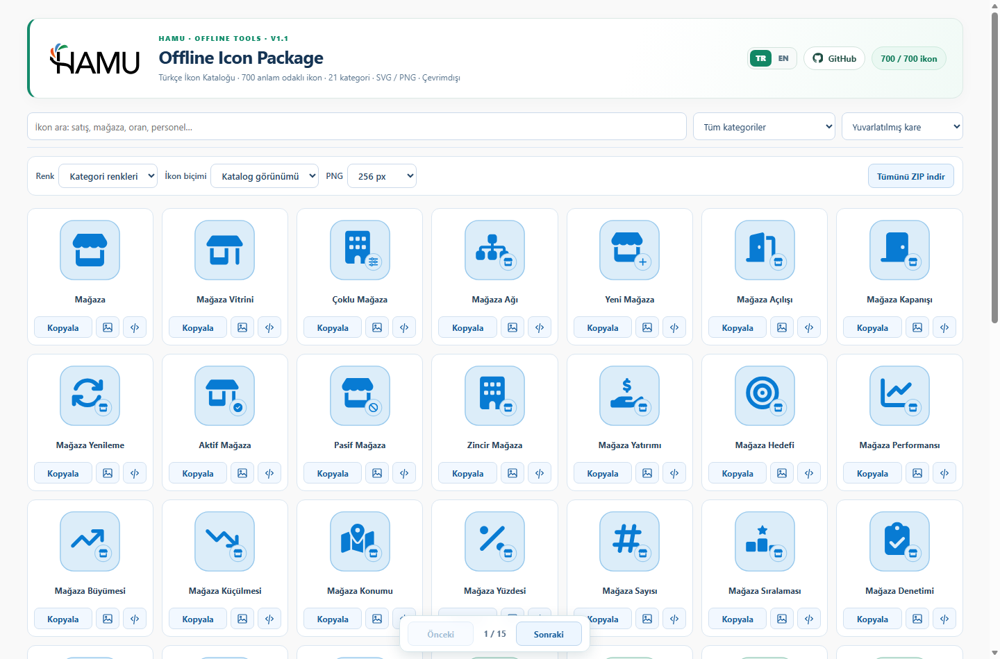

# HAMU Offline Icon Package

**v1.1** · [Türkçe](#türkçe) | [English](#english)

700 ikon · 21 kategori · SVG / PNG · TR / EN · Çevrimdışı / Offline

## Türkçe

### Nedir?

Rapor veya sunum hazırlarken uygun bir ikon bulmak için sürekli farklı sitelerde dolaşmak istemiyordum. O yüzden sık kullandığım kavramları tek yerde toplayan, açıp hemen kullanabileceğim küçük bir katalog hazırladım.

**HAMU Offline Icon Package**, kurulum gerektirmeyen bir ikon kataloğu. `index.html` dosyasını tarayıcıda açmak yeterli; sunucu, internet bağlantısı veya ek bir kütüphane gerekmiyor.

### Neler yapabiliyor?

- Satış, ciro, personel, mağaza, finans, grafik, KPI ve daha birçok konuda **21 kategoride 700 ikon** sunuyor.
- Türkçe ve İngilizce arayüzle çalışıyor. İkonları iki dilde de arayabiliyorsunuz.
- Katalog görünümü özgün bileşimleri gösterir. **Sade** tüm ikonlardan küçük alt simgeyi kaldırır. **Alt simgeli** yalnızca alt simgeli bileşimleri gösterir. Seçim kopyalama ve indirmelere de uygulanır.
- Renk paletleri, özel renk seçimi ve yedi farklı çerçeve seçeneği var.
- İkon kartına ya da **Kopyala** düğmesine tıklayarak görseli panoya kopyalayabiliyorsunuz.
- Tek bir ikonu **PNG** veya **SVG** olarak, dilerseniz koleksiyonun tamamını **ZIP** olarak indirebiliyorsunuz.
- Uzun listelerde arama ve sayfalama için ekranı gereksiz yere yormayan bir arayüz kullanıyor.

### v1.1’de neler yeni?

- 21 kategoriye 42 yeni ikon eklendi. Katalog 658’den 700 ikona çıktı. Yeni ikonlar arasında müşteri yolculuğu, kapasite planlaması, bütçe aşımı ve teslimat kanıtı var.
- **İkon biçimi** menüsünde **Katalog görünümü**, **Sade** ve **Alt simgeli** seçenekleri var. Seçilen biçim önizlemeye, kopyalamaya ve SVG, PNG, ZIP indirmelerine uygulanıyor.
- Küçük alt simgelerin boyutu ve konumu, ana ikonla daha dengeli görünmeleri için düzenlendi.

### Nasıl kullanılır?

1. [index.html](index.html) dosyasını indirin.
2. Dosyaya çift tıklayıp tarayıcınızda açın.
3. Arama kutusuna **mağaza** yazın. Örneğin **Yeni Mağaza** ikonunu bulun.
4. Küçük artı simgesini görmek için **Alt simgeli**, kaldırmak için **Sade** biçimini seçin.
5. Karttaki **Kopyala** düğmesini kullanın ya da ikonu **PNG** veya **SVG** olarak indirin.

Uygulamanın kendisi **tek HTML dosyasıdır**. HAMU logosu, favicon, stiller, JavaScript ve ikon çizimleri bu dosyanın içinde bulunur. README ve lisans dosyaları yalnızca proje belgeleridir.

> Not: Panoya resim kopyalama özelliği tarayıcının güvenlik izinlerine bağlıdır. Doğrudan kopyalama engellenirse uygulama alternatif bir kopyalama yolu gösterir.

---

## English

### What is it?

I kept finding myself searching different websites for the same kinds of icons whenever I worked on a report or presentation. I wanted something simpler: a small collection of useful icons that I could open and use straight away.

**HAMU Offline Icon Package** is a browser-based icon catalogue that needs no setup. Open `index.html` and you're ready to go. No server, internet connection, or external library is required.

### What can it do?

- Browse **700 icons across 21 categories**, including sales, revenue, people, retail, finance, charts, and KPIs.
- Switch between **Turkish and English** and search for icons in either language.
- Catalog appearance shows the original compositions. **Plain** removes the small badge from every icon. **Badged** shows only icons with a badge. The selected style applies to copying and downloads.
- Change colours and choose from seven icon backgrounds/shapes.
- Click an icon card or the **Copy** button to copy an image.
- Download an individual icon as **PNG** or **SVG**, or export the collection as a **ZIP** file.
- Navigate a large collection without having to load every icon onto the screen at once.

### What’s new in v1.1?

- Added 42 icons across 21 categories, bringing the total from 658 to 700. New icons include customer journey, capacity planning, budget overrun, and proof of delivery.
- The **Icon style** menu offers **Catalog appearance**, **Plain**, and **Badged**. The selected style applies to previews, copying, and SVG, PNG, and ZIP downloads.
- Adjusted the size and position of the badges to balance them with the main icon.

### Getting started

1. Download [index.html](index.html).
2. Open it in your browser.
3. Search for **store** and find the **New Store** icon.
4. Choose **Badged** to show the small plus badge or **Plain** to hide it.
5. Click **Copy** on the card or download the icon as **PNG** or **SVG**.

The app is contained in **one HTML file**. The HAMU logo, favicon, styles, JavaScript, and icon artwork are embedded. The other files in the repository are documentation and licensing information.

> Note: Image copying depends on browser clipboard permissions. If direct access is blocked, the app provides an alternative.

---

## License / Lisans

The application code is released under the **[MIT License](LICENSE)**. / Uygulama kodu **[MIT Lisansı](LICENSE)** ile paylaşılmaktadır.

The underlying vector artwork includes modified and combined glyphs from **Font Awesome Free 6.7.2** by Fonticons, Inc. These SVG source designs are licensed separately under **[CC BY 4.0](https://creativecommons.org/licenses/by/4.0/)** and are **not relicensed under MIT**. Attribution and details are in [THIRD_PARTY_NOTICES.md](THIRD_PARTY_NOTICES.md).

İkonlarda kullanılan bazı temel SVG çizimleri Font Awesome Free 6.7.2 kaynaklıdır. Bu çizimlerin lisansı MIT değil, **CC BY 4.0**'dır. Kaynak ve atıf bilgilerini [üçüncü taraf bildirimlerinde](THIRD_PARTY_NOTICES.md) bulabilirsiniz.

Project / Proje: **HAMU** · [Hüseyin Avni Uzun](https://github.com/huseyinavniuzun)
